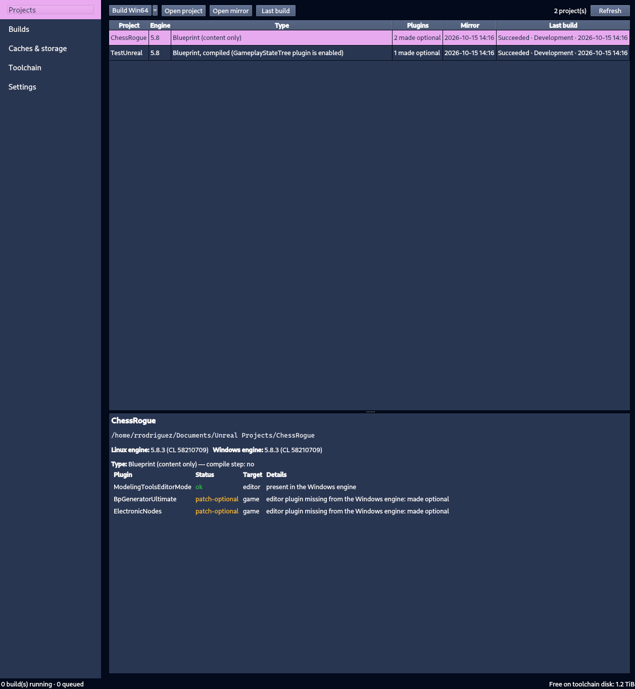
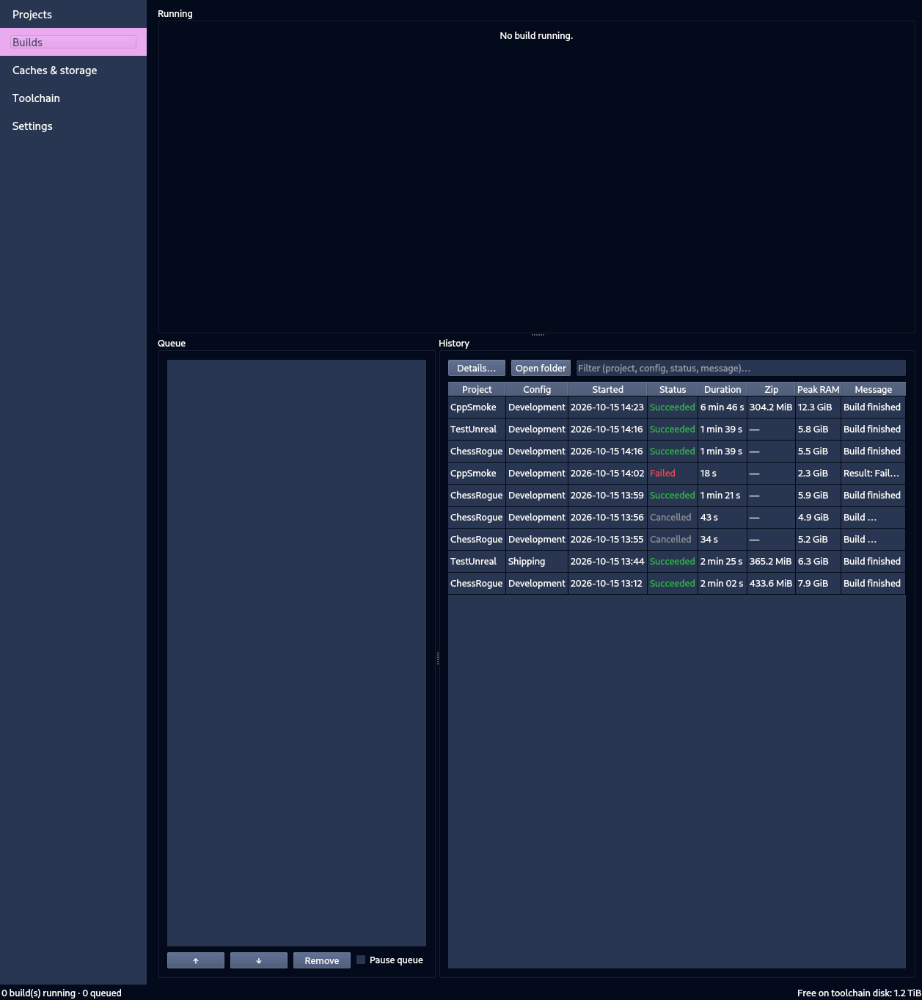
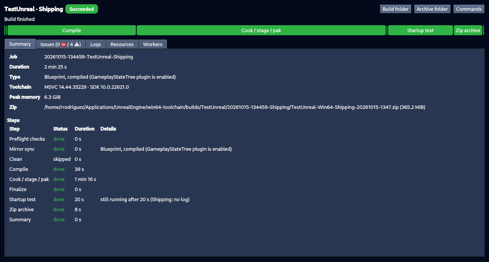
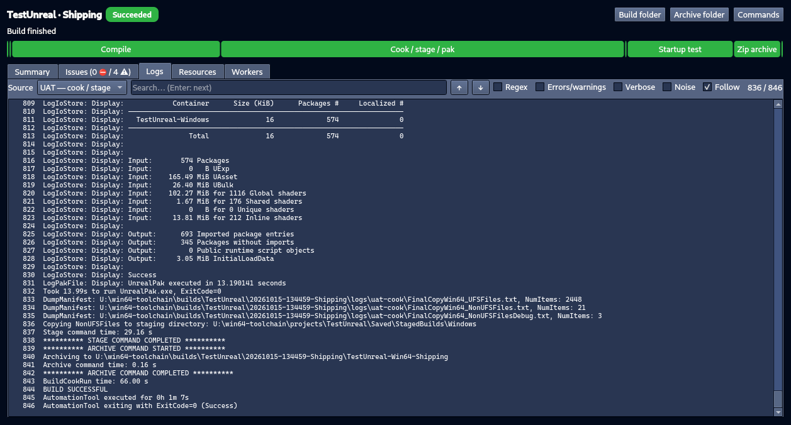
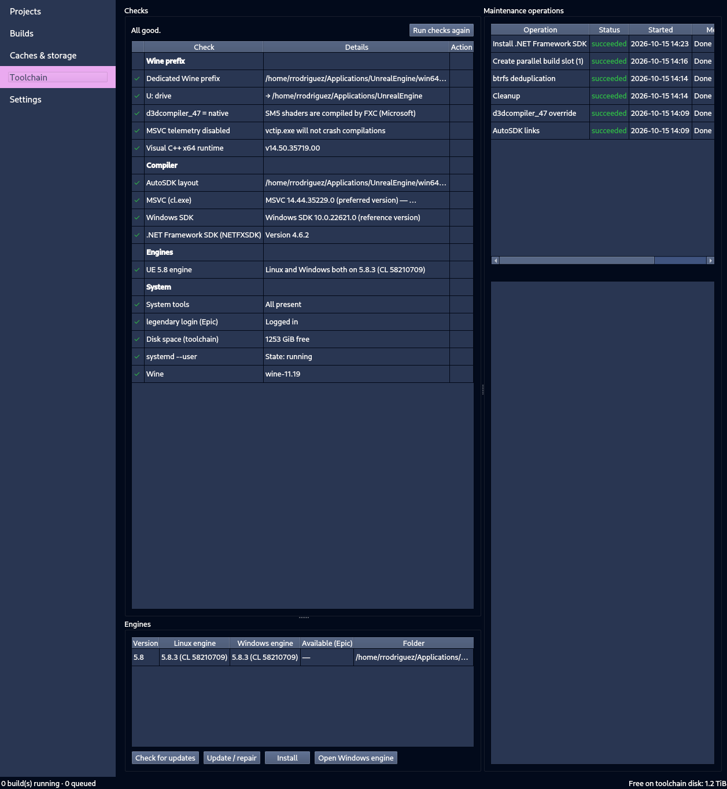
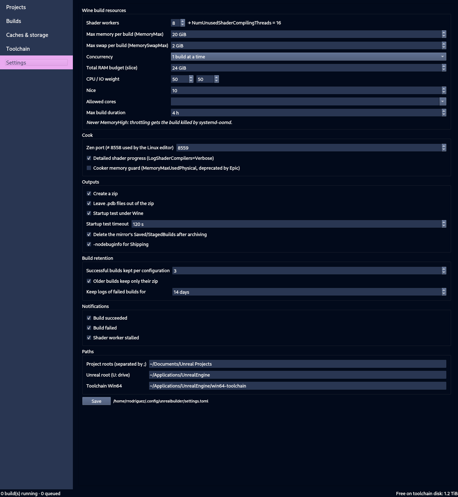
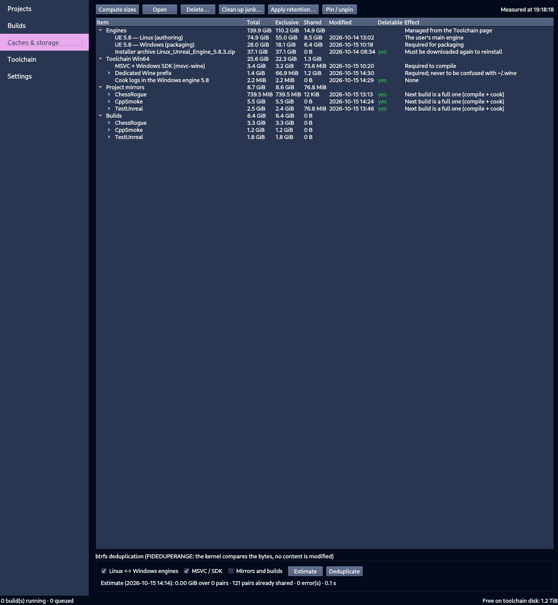

# UnrealBuilder

A desktop tool (Python + Qt6) to **package Unreal Engine projects developed on Linux into Windows (Win64) builds**,
with no virtual machine and no Windows editor on screen: a "core" Windows engine runs headless under Wine,
with MSVC provided by [msvc-wine](https://github.com/mstorsjo/msvc-wine).

Validated on UE 5.8.3 (CachyOS, Hyprland, Wine 11.19): the resulting builds start on a real Windows PC.

> **Platform support:** UnrealBuilder has been developed and tested **on Arch Linux only** (CachyOS, an Arch-based
> distribution). How it behaves on other distributions is unknown: package names, Wine builds, systemd or filesystem
> defaults may differ. Reports and fixes for other distributions are welcome (see [CONTRIBUTING.md](CONTRIBUTING.md)).



## What it does

| Page | Purpose |
|---|---|
| **Projects** | Lists the projects in `~/Documents/Unreal Projects`, their engine, their type (Blueprint, Blueprint compiled because of a plugin, C++), plugin and mirror status, and the last build. Starts a Development / Shipping build (clean or incremental). |
| **Builds** | Running builds (phase, progress, ETA, RAM/CPU, shader workers), queue (reorder, pause), filterable history. Detail window: summary, grouped issues, filterable logs, resources, workers. |
| **Caches & storage** | Real btrfs sizes (total / exclusive / shared) of the engines, toolchain, caches, mirrors and builds. Open folders, guarded deletion, "clean up junk", retention policy, deduplication. |
| **Toolchain** | Checks for the Wine prefix, MSVC, the Windows SDK, the .NET Framework SDK and the engines; one-click fixes; install / update of the Windows engine (legendary); operations log. |
| **Settings** | Shader workers, MemoryMax, swap, concurrency, CPU/IO weights, allowed cores, outputs (zip, startup test), retention, notifications. |



Build detail window (summary with the phase timeline, and the filterable logs):




## How it works

1. **Isolated mirror**: the Linux project is copied with **reflink** (0 bytes) into `win64-toolchain/projects/<Project>`.
   Your project is never modified. In the mirror only:
   - editor plugins missing from the Windows engine (e.g. a Fab plugin installed only on Linux) are set to `"Optional": true`;
   - a managed block is added to `DefaultEngine.ini`: number of shader workers, detailed shader progress, dedicated Zen port.
2. **Build in an isolated systemd unit** (`ub-build-*.service`, `unrealbuilder.slice`, `MemoryMax`, never `MemoryHigh`):
   preflight checks → sync → compile (if needed) → cook / stage / pak / archive (UAT under Wine) → startup test → zip → summary.
   The GUI is never the parent of the build: you can close it and reopen it, it reattaches.
3. **Outputs** in `win64-toolchain/builds/<Project>/<date>-<Config>/`: the `<Project>-Win64-<Config>/` archive, a zip to ship (without `.pdb`),
   logs, `summary.json` and `commands.sh` (the equivalent commands, to replay a build by hand).

## Requirements

Commands below are for Arch Linux, the only platform the tool has been tested on. On another distribution, look for
the equivalent packages (and expect some rough edges).

```bash
sudo pacman -S --needed pyside6 python-psutil python-pefile wine msitools p7zip btrfs-progs libnotify xdg-utils git
# legendary (Epic Games client): legendary-rare package (chaotic-aur), then:
legendary auth
```

## Installation

```bash
git clone https://github.com/rrodriguez06/UnrealBuilder.git ~/Documents/UnrealBuilder
cd ~/Documents/UnrealBuilder
python -m venv --system-site-packages .venv
.venv/bin/pip install -e '.[dev]'
.venv/bin/unrealbuilder install-desktop   # launcher + icon (app_id "unrealbuilder" for Hyprland)
.venv/bin/unrealbuilder                   # opens the GUI
```

First run: go to the **Toolchain** page → everything should be green. Each failing line offers its own fix button
(prefix creation, `d3dcompiler_47` override, VC++ runtime, AutoSDK links, MSVC, .NET Framework SDK, Windows engine…).
Microsoft installs (MSVC, .NET Framework SDK) ask you to accept the license **every time**; nothing is remembered.



## Command line

```bash
unrealbuilder discover                         # projects found
unrealbuilder analyze [Project] [-c Shipping]  # type, plugins, mirror patches
unrealbuilder sync Project --apply             # sync + patch the mirror
unrealbuilder run-job Project -c Shipping -f   # build in a systemd unit, followed live
unrealbuilder follow [build_dir]               # follow a build (the most recent by default)
unrealbuilder status                           # history and active builds
unrealbuilder cancel [build_dir]               # cancel
unrealbuilder doctor [--fix action]            # checks / fixes
```

## Resources and concurrency

- By default **one build at a time**, 8 shader workers, `MemoryMax=20G`, `MemorySwapMax=2G`, a 24 GiB slice budget.
- Two builds in parallel (experimental setting): each build gets a **slot** = its own Wine prefix
  (`wineprefix-slot1`, a reflink clone of the main one, with the shader cache already warm) and its own Zen port;
  workers are shared (4 + 4) and an admission check verifies the available memory.
  UAT allows only one instance per `wineserver`, hence one prefix per slot.



## Known pitfalls (handled automatically)

| Pitfall | What is done |
|---|---|
| Wine swaps Microsoft's FXC for its own HLSL compiler (hangs, wrong SM5 shaders) | `d3dcompiler_47=native` forced (registry + environment), verified in `/proc/<pid>/maps` of the shader workers |
| `systemd-oomd` kills the whole cgroup when RAM runs out | Builds run in their own unit, workers are capped, never `MemoryHigh` |
| Blueprint project treated as C++ by UAT (runtime plugin not enabled by default) | Same detection as UBT, `-unrealexe=UnrealEditor-Cmd.exe` always passed to the cook |
| C++ project: the editor target needs the .NET Framework SDK (SwarmInterface module) | Check + install of NETFXSDK 4.6.2 (Epic's AutoSDK recipe) |
| Zen port 8558 shared with the Linux editor | Port 8559 (then 8560 for slot 1) |
| UAT clears its log folder at startup | A separate `uebp_LogFolder` per step |
| Wine system processes ignoring SIGTERM | `KillMode=mixed`: the runner cleanly kills the prefix |

## Storage



- Deletions run in a systemd unit, through a guarded function: it refuses `~/.wine`, the projects, the engines,
  MSVC and the prefix itself (its caches can be emptied).
- Retention: 3 successful builds kept per configuration, older ones reduced to their zip, outputs of failed builds deleted,
  pinned builds never touched.
- btrfs deduplication (`FIDEDUPERANGE`): the kernel compares the bytes before sharing them, no file is modified;
  pairs that are already shared are detected (FIEMAP) and skipped.

## Development

```bash
.venv/bin/pytest                        # fast tests (no Wine, no systemd)
.venv/bin/pytest -m "systemd or btrfs"  # tests against a real systemd --user / real btrfs reflinks
.venv/bin/ruff check .
python tools/screenshots.py docs/screenshots        # offscreen screenshots
python tools/gui_reattach_check.py start Project    # real test: close/reopen the GUI during a build
python tools/concurrency_check.py ProjectA ProjectB # real test: two builds in parallel
```

Invariants and conventions for contributors: see [CONTRIBUTING.md](CONTRIBUTING.md).

## License

[MIT](LICENSE) © 2026 Romain Rodriguez
